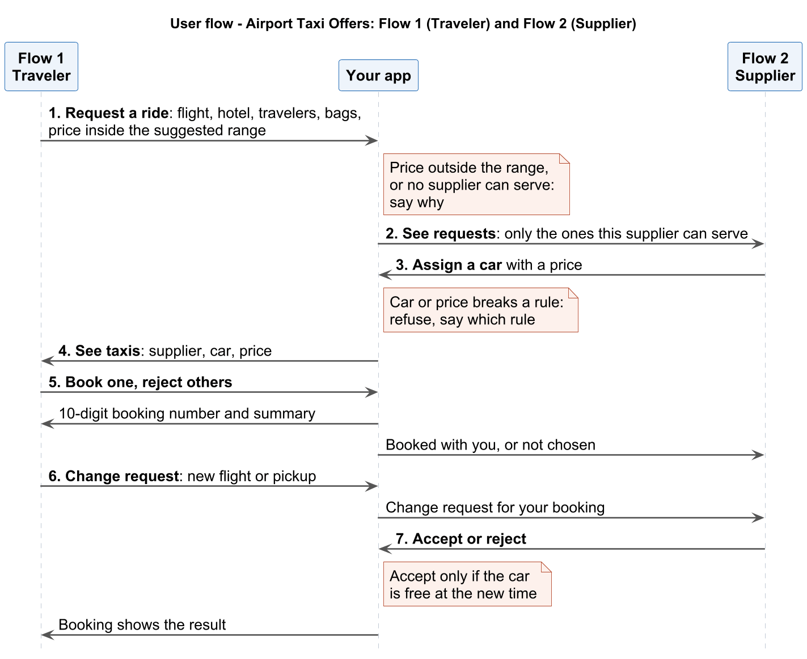

# Problem 2: Airport Taxi → Ride Offers

## At a glance

| Topic | In short |
|---|---|
| **The traveler gives** | Arrival flight, hotel, adults, children's ages, bags, (optional) pickup time, and **their price**. The platform suggests a price range for the route and refuses a price below the minimum or above the maximum. |
| **Taxi suppliers** | See the ride requests they can serve, with all details, and **assign a car with a price** |
| **The traveler can** | See the taxis from several suppliers with their prices, and **Book** or **Reject** each one |
| **At the end** | The traveler gets a **10-digit booking number** that opens a summary of the ride, and can send a change request if the flight changes |
| **The event** | Teams of 2. About 9–10 hours to build. A 12-minute demo at the end. |

---

## 1. The users

After a long flight, travelers want a ride to the hotel that is ready when they land, fits their family and bags, and costs what they expect to pay. Taxi suppliers want to fill their cars with rides they can do. Build a platform where travelers post a ride request with their price, and suppliers assign cars.

**Scenario 1: the Menon family (traveler).** The family from Bengaluru lands at Narita and needs a taxi to their hotel in Ueno. They want a fair price and a car that fits their bags.

**Scenario 2: Sakura Cabs (supplier).** A taxi company that works at Narita and Haneda. It wants to see the ride requests it can do, and assign the right car at a good price.

| | Traveler: Menon family | Supplier: Sakura Cabs |
|---|---|---|
| Wants | A ride from Narita to Ueno at a fair price | To fill its cars with rides it can do |
| Gives | Flight FL-401 (lands NRT 10 April 2027, 10:30), hotel Ueno Garden Inn (HTL-TYO-004), 2 adults + 1 child (age 6), 3 large + 2 small bags, pickup 11:30, price ₹12,000 | A car and a price for each request it takes |
| Sees | The suggested price range (₹10,200 – ₹16,800 for Narita to Ueno), then the taxis from all suppliers | Only the requests it can serve, with all details |
| Does | Books one taxi, rejects the others, asks for a change if the flight changes | Assigns a car with a price, accepts or rejects change requests |

---

## 2. What you build

A web application with a **backend** and a **frontend** that work together. It has two flows. No login is needed: let the user choose who they are (the traveler, or one of the suppliers in the data).

**Flow 1: Traveler.** Choose flight and hotel → See the suggested price range → Post the request with your price → See the taxis → Book one or reject → Get the booking number and summary → If the flight changes, send a change request → See it accepted or rejected

**Flow 2: Supplier.** Choose your company → See the requests you can serve → Open a request → Assign a car and a price → See if the traveler booked it → Accept or reject change requests for your bookings

---

## 3. Inputs you receive

| File | What it is |
|---|---|
| `data/problem-2/taxi_companies.json` | Taxi suppliers: airports, areas they drive to, opening hours, and their cars (type, seats, bags) |
| `data/problem-2/routes.json` | For each airport and hotel area: drive time, distance, and the suggested price range (`price_min_inr`, `price_max_inr`) |
| `data/problem-2/booked_rides.json` | Rides booked before the event. Each one keeps a car busy. |
| `data/problem-2/open_requests.json` | Ride requests that are open at the start |
| `data/catalog/flights.json`, `hotels.json`, `airports.json` | Flights (local arrival times), hotels (city and area), and the cities each airport serves |

`DATA_DICTIONARY.md` explains every field. All prices are in INR. Flights exist from **1 to 20 April 2027** only.

---

## 4. Rules

A ride is correct only if every rule is true. Judges check every rule.

**R1. Ride request**

- The flight and the hotel come from the catalog. The arrival airport serves the hotel's city.
- At least 1 adult. A child is anyone aged 0 to 17.

**R2. Pickup**

- The pickup is at least 60 minutes after landing (local time). The traveler can choose a later pickup.

**R3. Price range**

- The platform suggests the range of the route: `price_min_inr` to `price_max_inr` in `routes.json` (the airport of the flight to the area of the hotel).
- The traveler's price must be inside the range. A price below the minimum or above the maximum is refused.

**R4. Which suppliers see a request**

- A supplier sees a request only if it works at the arrival airport, drives to the hotel's city and area, is open at the pickup time, and has a car that fits and is free.

**R5. Car fits**

- Seats ≥ passengers, children included.
- Large bags and small bags fit (`large_bags`, `small_bags`).
- Car types: `HATCHBACK`, `SEDAN`, `SUV`, `BUS`.

**R6. Car is free**

- A car is busy from the pickup until pickup + 2 × `drive_minutes` (to the hotel and back to the airport).
- Two busy times of one car never overlap. Rides in `booked_rides.json` count.

**R7. Assign a car**

- A supplier assigns one of its cars with a price. The price must be inside the range (R3).
- The platform refuses a car that breaks R4, R5, R6, or the price range, and says which rule it breaks.

**R8. Book or reject**

- The traveler sees every assigned taxi and books one, or rejects one. A rejected taxi cannot be booked.
- Booking gives a unique 10-digit booking number. The other taxis for that request become "not chosen", and the booked car is now busy (R6).
- Booking a car that became busy is refused.

**R9. Change request**

- After booking, the traveler can send a change request: a new flight or a new pickup time.
- The supplier accepts or rejects it. The platform accepts only if the new pickup follows R2 and the same car is free at the new time. A rejected change keeps the old booking.

---

## 5. Features

### Must have

The Flow column shows who uses each feature.

| # | Flow | Feature | Done when |
|---|---|---|---|
| M1 | Traveler | **Ride request** | The traveler enters the flight, hotel, adults, children's ages, bags, an optional pickup time, and their price. The form shows the suggested price range. A request that breaks R1, R2, or R3 shows a clear message. |
| M2 | Supplier | **Supplier dashboard** | Each supplier sees only the open requests it can serve (R4), with all request details. When no supplier can serve a request, the traveler sees this and why. |
| M3 | Supplier | **Assign a car** | A supplier assigns a car with a price. A car or price that breaks a rule is refused with the reason (R7). |
| M4 | Traveler | **Book or reject** | The traveler sees the taxis from all suppliers with the supplier, car, and price, and can book or reject each one (R8). |
| M5 | Traveler | **Booking summary** | The booking number opens a summary: flight, hotel, pickup, supplier, car, and price. It works after a backend restart. A wrong number shows "not found". |
| M6 | Both | **No double booking** | Before confirming a booking, the backend checks that the assigned car has no existing booking whose busy time (R6) overlaps the new ride. If it does, the booking is rejected and the traveler sees an error. Sequential correctness is enough: you do not need to handle two simultaneous requests racing for the same car. |
| M7 | Both | **Flight change** | The traveler sends a change request for a booking (new flight or pickup). The supplier accepts or rejects it (R9). The booking shows the result. |

### Good to have

| # | Feature | Done when |
|---|---|---|
| G1 | **Several cars per supplier** | One supplier can assign several cars to one request, each with its own price. |
| G2 | **Car type** | The traveler can choose a car type (Hatchback, Sedan, SUV, Bus). Suppliers can only assign that type. |
| G4 | **Offer expiry** | A supplier can set a time when its assigned taxi ends. An ended taxi cannot be booked. |
| G5 | **Sort and filter** | The traveler can sort taxis by price and filter by car type. |

### Stretch

| # | Feature | Done when |
|---|---|---|
| S1 | **Shared ride** | Two requests on the same flight to the same area can share one car, if it fits everyone. |
| S2 | **Your own idea** | Any other feature that makes airport rides easier for travelers or suppliers. |

---

## 6. Technical rules

| Rule | Detail |
|---|---|
| Any stack | Any language, framework, and database |
| Data files only | Flights, hotels, suppliers, cars, routes, price ranges, and booked rides come from the data files. Do not change the data files. |
| Backend holds the logic | The rules, the price checks, the car checks, and the bookings run in the backend. The frontend gets all data from your backend API. |
| State is saved | Requests, assigned taxis, bookings, and change requests survive a page refresh and a backend restart. |
| No AI inside the app | Your app must not call an AI or LLM model (cloud or local). AI tools to help you write code are allowed. |
| Start in 1–2 commands | Write the commands in your README. |
| Build during the event | Templates and open-source libraries are allowed. Feature code is written during the event. We check the Git history. |

---

## 7. How we judge

| Area | Weight |
|---|---|
| Working end-to-end feature (Must / Good / Stretch reached) | 25% |
| Correctness on new requests and cars given by the judges | 25% |
| Individual understanding (questions to each member, one small live code change) | 20% |
| Product and user experience | 15% |
| Engineering quality (code structure, data model, README, Git history) | 15% |

The judges post **requests you have not seen** at other airports, with other travelers, bags, and prices. They also play a supplier and try cars and prices that break a rule, and they send change requests. They check the results on your screen.

| The request has... | Your app must... |
|---|---|
| Suppliers that can serve it | Show it to those suppliers only, accept valid cars, refuse bad ones |
| No supplier that can serve it | Say so, with the reason (M2) |
| A price outside the range | Refuse it and show the range (M1) |
| A value that is not valid | Show a clear message (M1) |

---

## 8. Demo and submission

**Demo (12 minutes):** 4 minutes live demo with the Menon request (post it with their price, assign cars as two suppliers, show one refused car, reject one taxi, book the other, open the booking, send a change request and accept it), 3 minutes of judge requests, 4 minutes of questions, 1 minute changeover. Before your slot: app running.

**Submission:**

1. Push your code to your Git repository every hour.
2. At code freeze, upload a zip file to HackerEarth with your source code, `README.md`, and setup scripts. No `node_modules`, virtual environments, build output, or API keys.
3. The `README.md` says how to start the app, the architecture, what you finished, and known limitations.

---

## 9. FAQ

**Can we use AI tools to write code?** Yes. You must understand and explain all your code.

**Do we need user login or payments?** No. Let the user choose to be the traveler or a supplier.

**Is a booking a real booking?** No. It is saved in your app. There is no payment, and the data files do not change.

**How does a supplier choose its price?** Any price inside the route's range. It can be different from the traveler's price.

**Must the traveler book the cheapest taxi?** No. The traveler chooses.

**Must we deploy the app online?** No. It runs on your laptop for the demo.

**Can we change the data files?** No. Judges use the original files.

**Do we need to handle two users booking the same car at the exact same time?** No. Check availability when the booking is confirmed. If the car is already taken, reject the booking. You do not need database-level locking or optimistic concurrency control.

**Where do we ask questions?** At the help desk or in the event chat channel. We send every answer to all teams.
